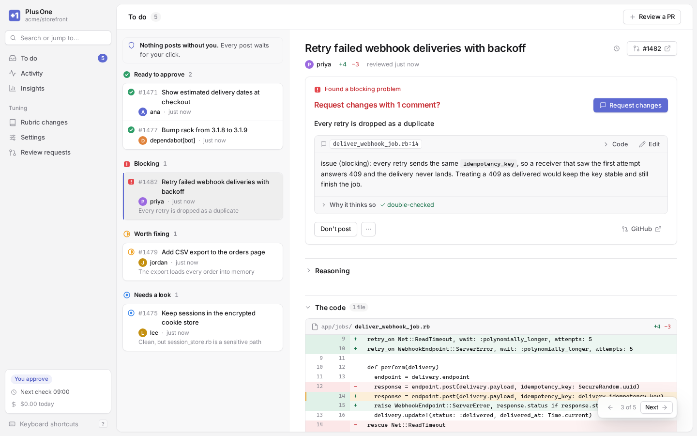

<div align="center">

# Plus One

Review more pull requests. Keep your team moving. Stay in the loop.

[](https://github.com/andymai/plus-one/actions/workflows/ci.yml)
[](https://github.com/andymai/plus-one/releases)
[](./LICENSE)

</div>

https://github.com/user-attachments/assets/a3c0de6b-d4f3-4bb9-bde8-4d7a0cd8aef7

The video shows a sandbox with invented pull requests for `acme/storefront`. Nothing in it reaches GitHub.

Plus One helps you review many pull requests, so your team keeps moving fast and you stay in the loop. It runs Claude Code on your own machine and reads each PR that waits on you. It sorts each PR by the decision it needs from you, and it drafts the comments in your voice. You read, you click, and only then does it post.

## What you see

<picture>
  <source media="(prefers-color-scheme: dark)" srcset="docs/media/to-do-dark.png">
  
</picture>

Each PR lands on To do in one of these groups:

- **Ready to approve.** It traced the change and found no problem. You approve with one click.
- **Blocking.** It found a problem that must not ship, and the comment is ready to post.
- **Worth fixing.** It found a problem that does not block the PR. The comment posts with your approval.
- **Needs a look.** It could not decide, or the change touches code that only you approve.
- **Fixed since you asked.** You requested changes and the author pushed again. It tells you which of your comments the new code fixes.

It finds these PRs from review requests in the repositories you choose, which includes requests to your teams. It can also read PR links from Slack channels that you select.

## How a comment gets to you

1. Plus One checks out the PR in a temporary worktree, and Claude Code reads the change with read-only tools.
2. A second model call tries to prove each finding against the code. A finding that fails becomes a private note, not a comment.
3. It drafts each comment from your rubric. Then a fact-check compares the text with the evidence, and it flags a comment that the evidence does not support.

Each comment shows what the reviewer saw and how it made sure. You can edit the text, or ask for a rewrite ("shorter", "as a question", or your own words).

## What it does not do

- **It does not post without you.** In the web app, each post waits for your click, and then you have 8 seconds to undo it.
- **It does not approve on its own.** That switch is off for each repository until you turn it on. Insights shows how often its calls agreed with yours, so you can decide when a repository is ready.
- **It does not approve code that you fence off.** You name the CODEOWNERS teams and the paths. Files that instruct the reviewer, such as `CLAUDE.md`, are always on that list.
- **It does not give the model your GitHub login.** The reviewer runs with read-only tools, in an environment with no GitHub credentials.
- **It does not keep spending all day.** You set a daily amount. When the day's spend reaches it, the timer starts no more reviews.

## It learns how you review

`bin/plus1 learn` reads the reviews you wrote on GitHub and proposes your rubric from them. After that, when you mark a call wrong, or your GitHub review differs from its call, it drafts a change to the rubric. You see each change as a diff, and you accept or reject it.

Plus One runs on your own Mac or Linux machine, with your GitHub and Claude Code logins.

## Start

You need macOS or Linux, git, the GitHub CLI (`gh`) signed in, Claude Code signed in, and either uv or Python 3.11 or newer.

```sh
git clone https://github.com/andymai/plus-one.git
cd plus-one
bin/plus1 setup
```

The first run creates its own Python environment. Setup asks which repositories to use, where your clones are, which teams' PRs it should never approve automatically, and your working hours. It writes configuration to `~/.config/plus1/config.toml` and stores your rubric beside it.

Setup can learn your rubric from your GitHub reviews for about $1. It also installs a timer that checks for PRs every 30 minutes during your working hours, then opens the web app.

## Web app

Run `bin/plus1 open` to open the signed-in web app at http://127.0.0.1:8470. To reach it from your phone, you can serve it over Tailscale instead.

## Commands

Run commands as `bin/plus1 <command>`.

| Command | Description |
| --- | --- |
| `setup` | Set Plus One up, step by step. |
| `doctor` | Check its requirements and show how to fix anything missing. |
| `update` | Install the latest version now and restart it. It also does this on its own, and `--rollback` goes back one version. |
| `open [--new]` | Open the web app signed in. `--new` signs every browser out first. |
| `install [--no-web]` | Start the timer and, unless excluded, the web app. |
| `uninstall` | Remove the timer and web app. |
| `learn [--plan]` | Learn your rubric from GitHub reviews. `--plan` only counts what it would read. |
| `tick [--plan] [--pr N]` | Check for PRs now. `--plan` applies filters without model calls. |
| `status` | Show each repository's mode, pause state, and queued drafts. |
| `pause` / `resume` | Stop or restart checking. |
| `release N` | Post queued comments. If none blocks, also approve the PR. |
| `dismiss N [--no-approve]` | Discard queued comments. If none blocks, also approve unless `--no-approve` is set. |
| `ignore N` / `unignore N` | Hand a PR to other reviewers, or bring it back. |

## Read more

Start with `docs/onboarding.md` for setup, the first week, teaching Plus One, costs, safety, and Mac notes.

See `docs/admin.md` for repository maintenance, `DESIGN.md` for how a review works, `UI-PLAN.md` for the web app, and `CLAUDE.md` for working on the code.

## Contributing

See [CONTRIBUTING.md](CONTRIBUTING.md) for working on the code and the checks. See [SECURITY.md](SECURITY.md) for reporting a vulnerability.
